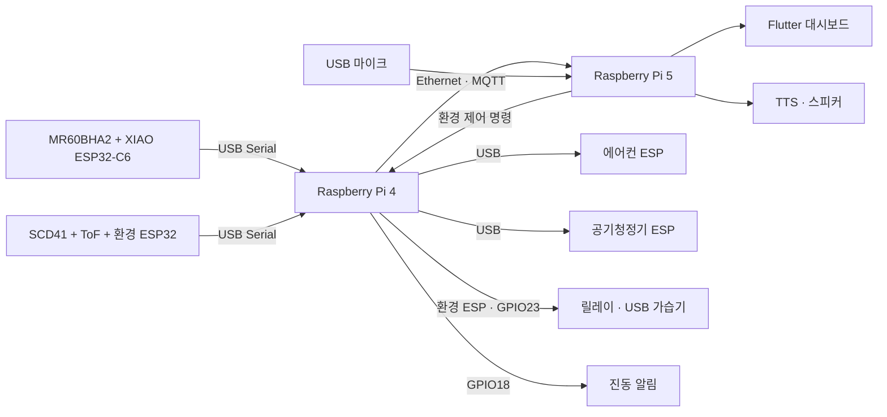

# 2026ESW_NUNI

**NUNI**는 레이더, 환경 센서, 소리 분석을 연결하는 영유아 케어 프로젝트입니다. Raspberry Pi 4가 유선 센서와 장치를 관리하고, Raspberry Pi 5가 울음 분석·환경 제어·음성 안내·대시보드를 담당합니다.

## 주요 기능

- **아기 상태 확인**: MR60BHA2의 호흡 신호와 ToF 거리 변화를 수신합니다.
- **울음 안내**: YAMNet으로 울음 여부를 분석하고, 시간·환경·돌봄 기록을 함께 활용합니다.
- **환경 제어**: SCD41의 온습도·CO₂를 읽고 가습기 릴레이와 가전 ESP를 제어합니다.
- **음성 안내**: ToF에서 지속적인 거리 변화를 감지하면 Pi 5 스피커로 TTS를 재생합니다.
- **현재와 과거**: Flutter 화면에서 현재 상태, 울음 시간대, 돌봄 행동과 환경 기록을 확인합니다.
- **ThinQ 연동**: 공식 Python SDK의 명령 흐름과 USB 가전 모형을 연결합니다.

## 시스템 구성



| 장치 | 역할 |
|---|---|
| Pi 4 · `10.77.0.4` | USB 센서 수집, MR60·ToF 처리, 릴레이·가전 ESP·진동 제어 |
| Pi 5 · `10.77.0.5` | YAMNet, 울음 기록·맥락 안내, TTS, 환경 제어 정책, Flutter |
| 환경 ESP32 | SCD41·VL53L1X 측정, GPIO23 가습기 릴레이 |
| XIAO ESP32-C6 | MR60 UART 데이터를 USB JSON 프레임으로 전달 |
| 가전 ESP32 2대 | 에어컨·공기청정기 역할의 LED 상태 표시 |

두 Pi는 랜선으로 연결합니다. 센서와 ESP는 Pi 4에 USB로 연결합니다.

## 폴더

```text
atlas/nuni/        C++ 센서 허브·융합·울음 분석·D-Bus 서비스
atlas/dashboard/   Flutter 현재 상태·과거 기록 화면
esp32/nuni_env/    환경 센서·ToF·가습기 릴레이 펌웨어
esp32/nuni_appliance/  에어컨·공기청정기 ESP 펌웨어
appliance_bridge/  ThinQ SDK 어댑터·환경 정책·USB 게이트웨이
deploy/           MR60 USB 펌웨어 설정과 구성 요소
cry_model/        YAMNet 모델 준비 도구
```

## 빌드와 실행

### ESP32

```sh
pio run -d esp32/nuni_env
pio run -d esp32/nuni_appliance -e air_conditioner
pio run -d esp32/nuni_appliance -e air_purifier
esphome run deploy/mr60bha2_usb.yaml
```

환경 센서 I²C는 SDA GPIO21, SCL GPIO22를 사용합니다. 가습기 릴레이 입력은 GPIO23이며 active-low 방식입니다. 릴레이 접점으로 가습기 USB 5V 전원을 스위칭합니다.

### Pi 서비스

LG atlas SDK 환경에서 C++ 서비스를 빌드합니다.

```sh
export ATLAS_SDK_ROOT=/path/to/atlas-sdk
bash atlas/nuni/deploy/build_with_local_sdk.sh
```

Pi 4·5의 고정 랜 주소를 설정합니다.

```sh
sh atlas/nuni/deploy/setup_direct_lan.sh pi4
sh atlas/nuni/deploy/setup_direct_lan.sh pi5
```

각 명령은 해당 Pi에서 실행합니다. 서비스 설치와 USB 포트 등록은 [설치 안내](docs/SETUP.md)를 참고하세요.

### 환경 정책과 가전

```sh
python -m pip install -r appliance_bridge/requirements.txt
python appliance_bridge/probe_thinq.py
python appliance_bridge/policy.py
```

온도 하강 시 가전 ESP의 동작 상태를 켜고, 습도가 낮아지면 가습기 릴레이를 켭니다. 회복 구간은 별도 문턱값을 두어 전환을 안정화합니다. 측정값과 명령의 유효 시간을 관리하며, 연결이 끊기면 릴레이와 가전 ESP가 자동으로 꺼집니다.

| 제어 대상 | 켜짐 조건 | 꺼짐 조건 |
|---|---|---|
| 가전 ESP | 22°C 미만이 3초 지속 | 22.5°C 이상 |
| 가습기 | 습도 35% 미만이 3초 지속 | 습도 40% 이상 |

### 대시보드

atlas Flutter 개발 환경에서 실행합니다.

```sh
cd atlas/dashboard
flutter-atlas pub get
flutter-atlas test
flutter-atlas build atlas --release --ipk
```

## 검사

```sh
python -m unittest discover -s appliance_bridge/tests -v
cmake -S atlas/nuni -B build/native
cmake --build build/native
ctest --test-dir build/native --output-on-failure
```

## 작성자

[wlsdn66597](https://github.com/wlsdn66597)
